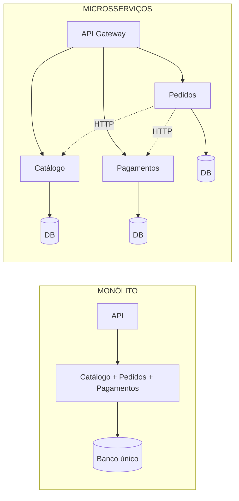
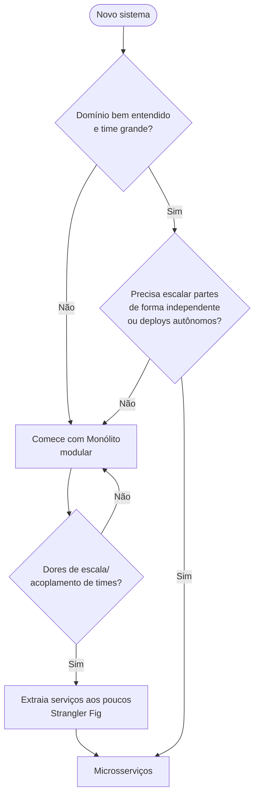
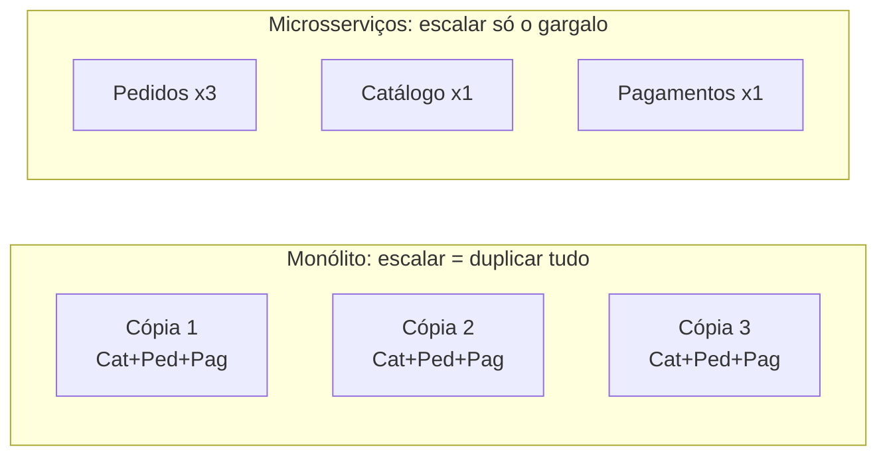
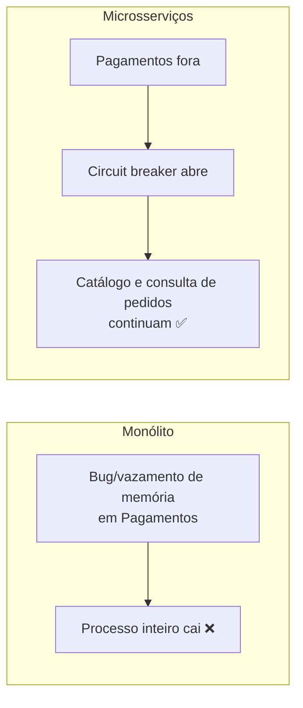
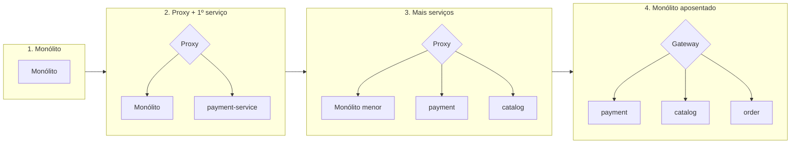
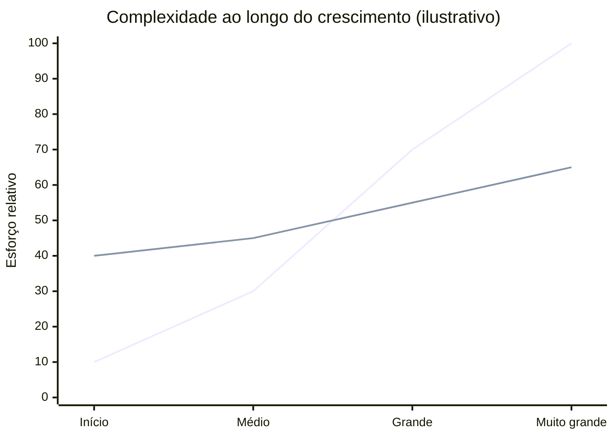
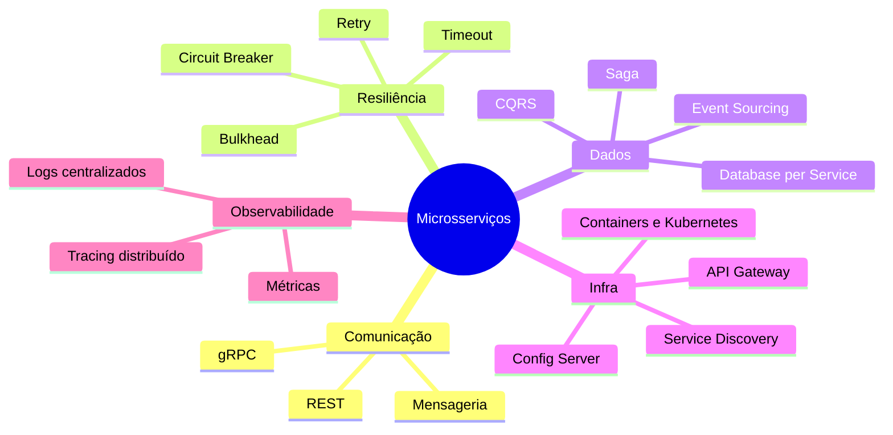

# Conceitos: Monólito × Microsserviços

## Visão geral

## Comparativo

| Aspecto | Monólito | Microsserviços |
|---|---|---|
| Deploy | Um artefato, tudo junto | Independente por serviço |
| Comunicação | Chamada de método (ns) | Rede HTTP/mensagens (ms), pode falhar |
| Dados | Banco único, transação ACID | Um banco por serviço, consistência eventual (Saga) |
| Escala | Replica a aplicação inteira | Escala só o serviço gargalo |
| Tecnologia | Uma stack | Poliglota possível |
| Falhas | Uma falha pode derrubar tudo | Isolamento (com circuit breaker) |
| Complexidade operacional | Baixa | Alta (observabilidade, CI/CD, service discovery) |
| Time-to-market inicial | Rápido | Mais lento no início |
| Times | Poucos, coesos | Muitos, autônomos (Lei de Conway) |
| Testes | E2E simples | Contratos + integração distribuída |
| Debug | Stack trace único | Tracing distribuído |

## Quando usar cada um

## Escalabilidade

## Propagação de falhas

## Estratégia de migração (Strangler Fig)

## Evolução dos custos

*(linha 1: monólito; linha 2: microsserviços — alto custo inicial, crescimento mais suave)*

## Padrões típicos de microsserviços

