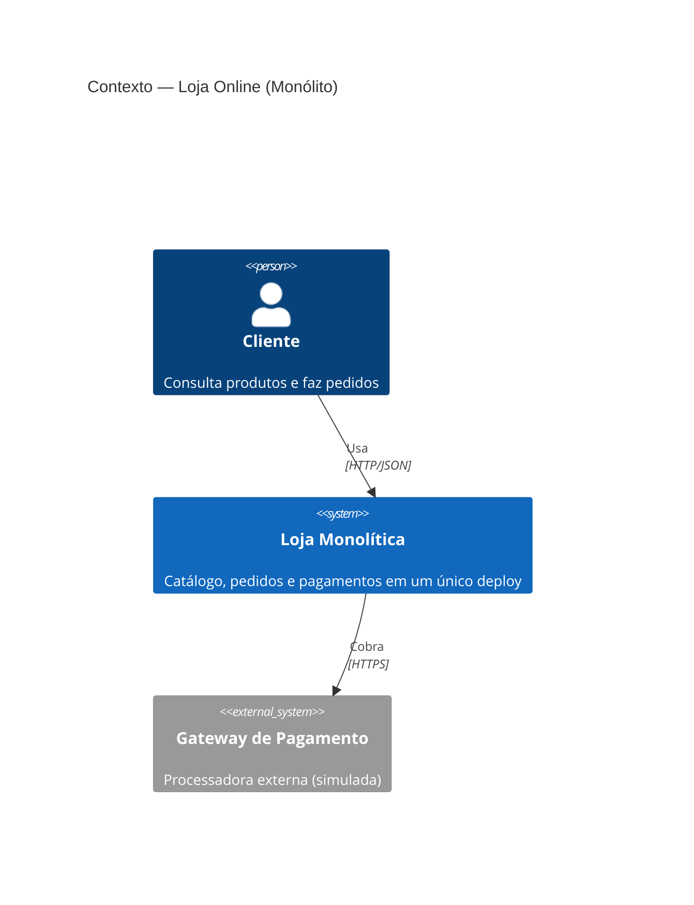
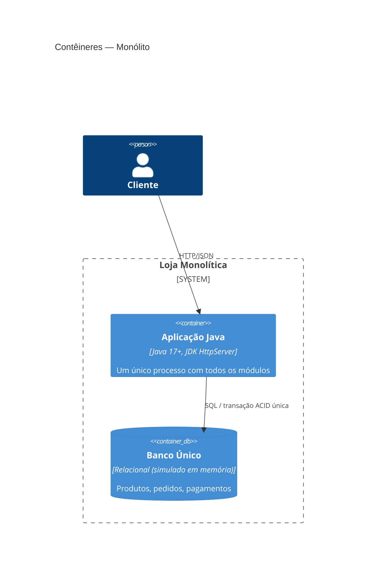
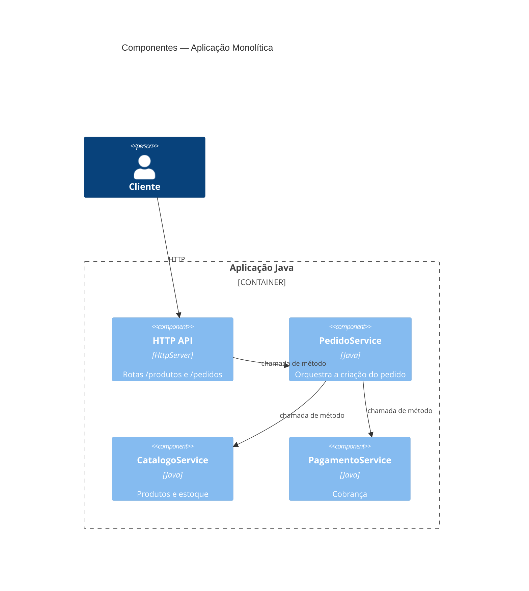
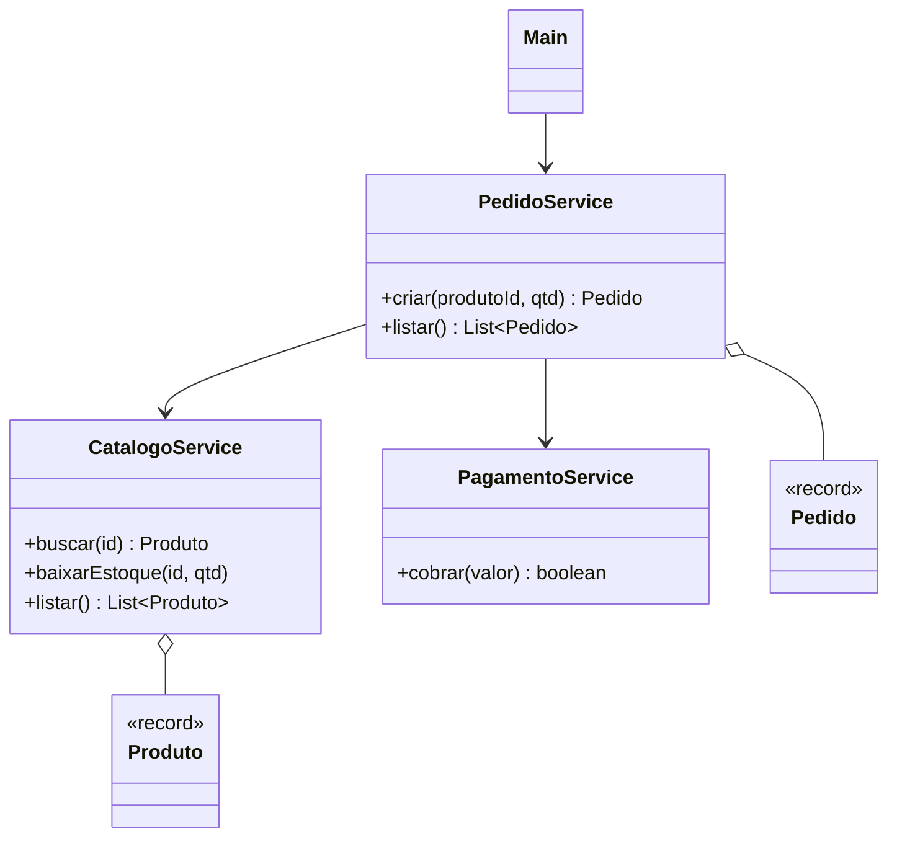
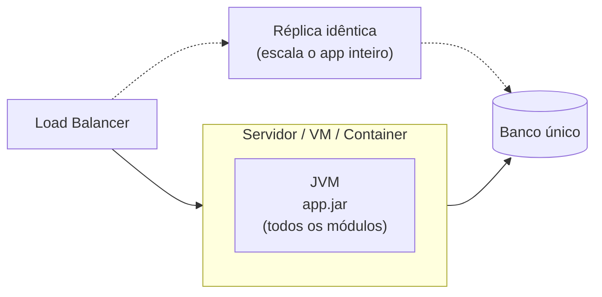

# C4 Model — Monólito

Diagramas C4 em Mermaid (renderizam nativamente no GitHub). Código: [`monolith/`](../monolith).

## Nível 1 — Contexto

## Nível 2 — Contêineres

## Nível 3 — Componentes

## Nível 4 — Código (classes)

## Deployment

