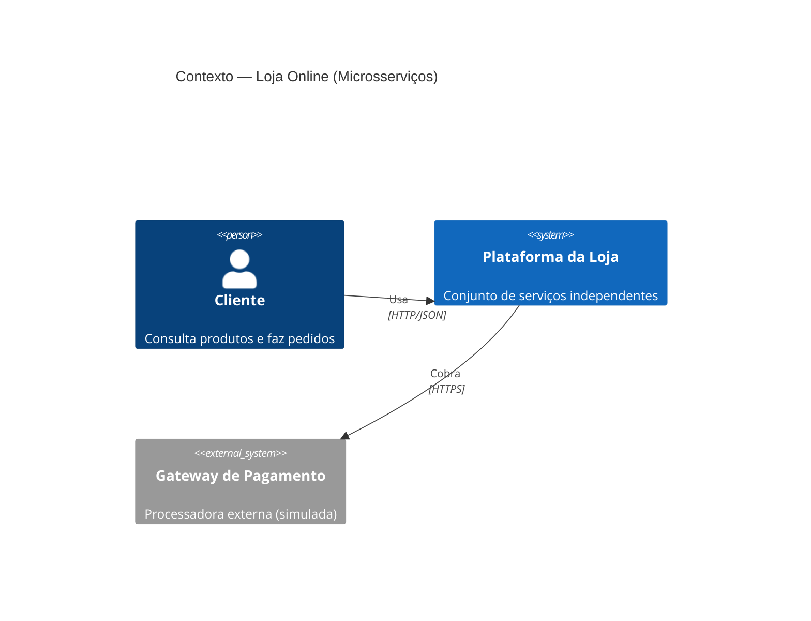
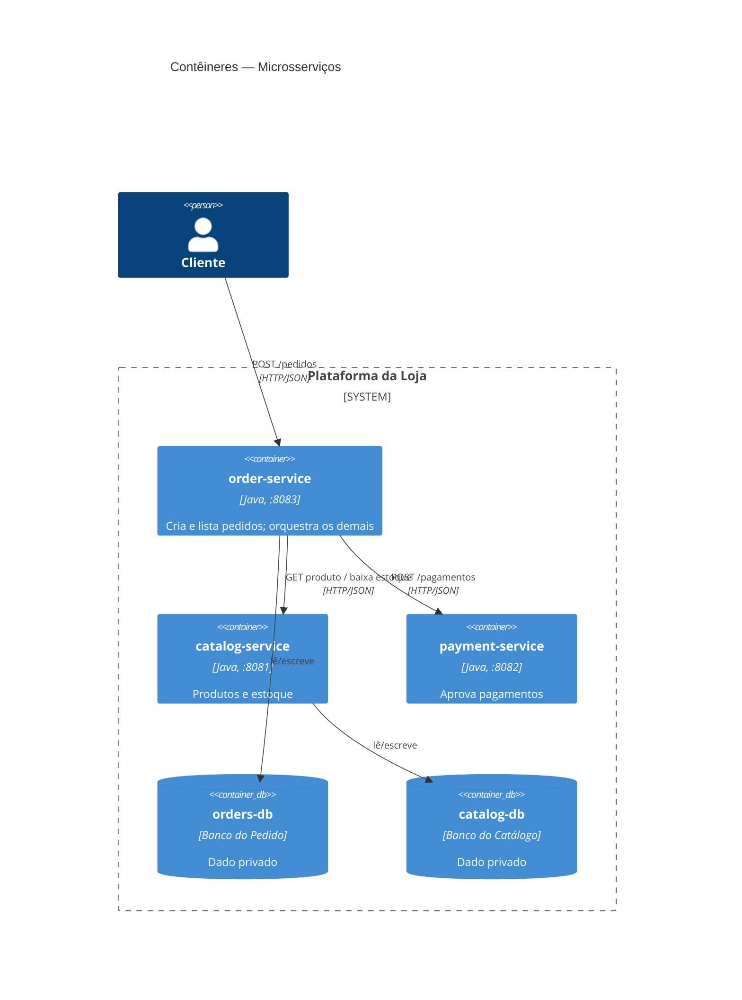
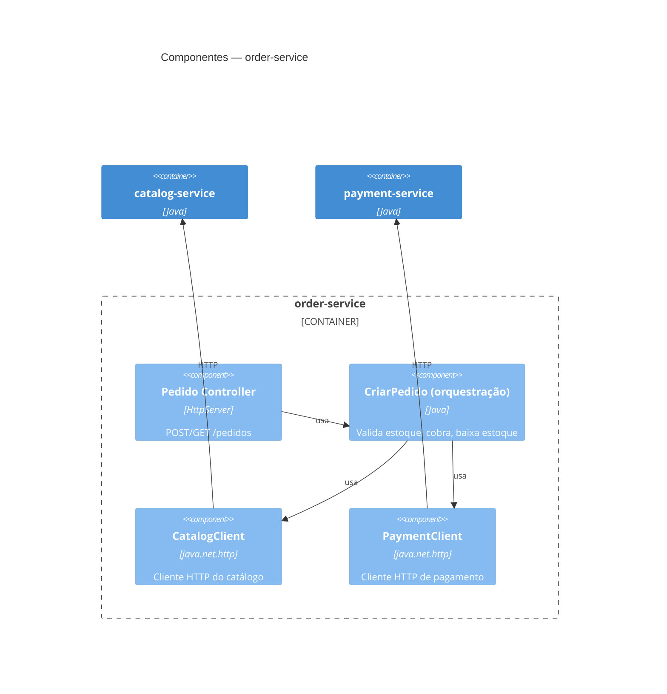
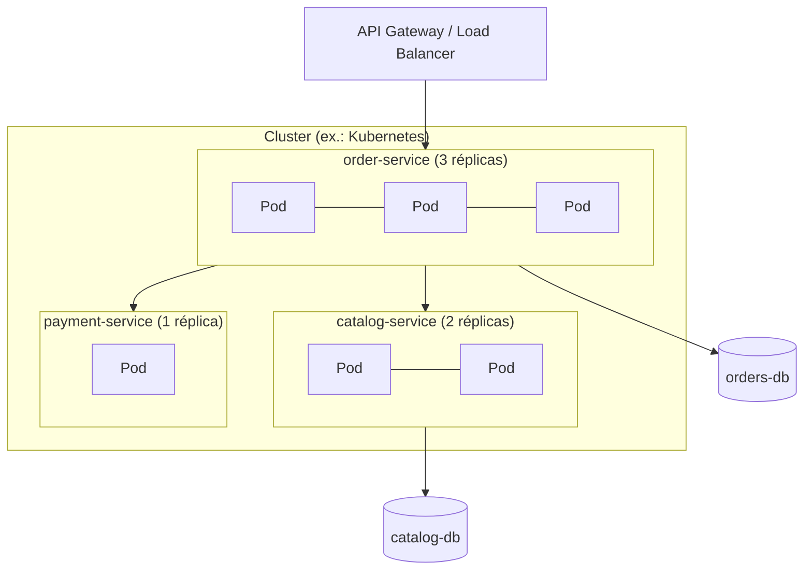
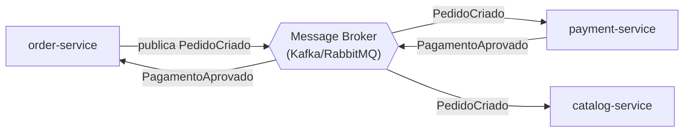

# C4 Model — Microsserviços

Código: [`microservices/`](../microservices).

## Nível 1 — Contexto

## Nível 2 — Contêineres

## Nível 3 — Componentes do order-service

## Deployment

> Note: cada serviço escala de forma independente (ex.: pedidos tem 3 réplicas, pagamento 1).

## Variante com mensageria (assíncrona)

