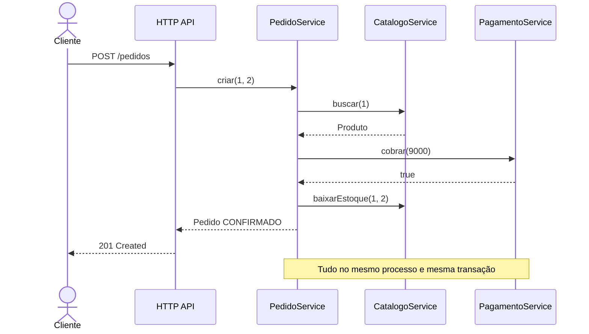
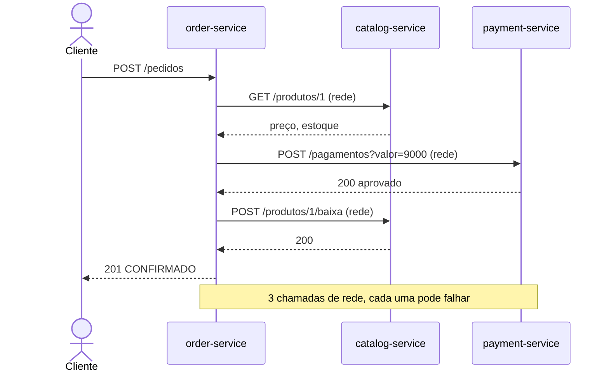
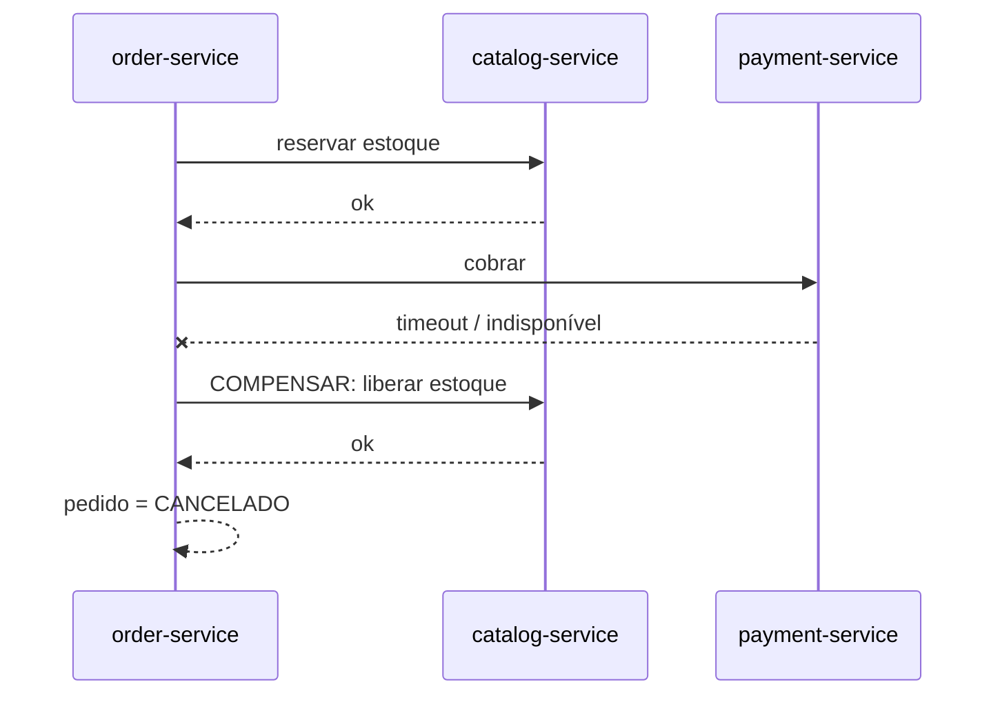
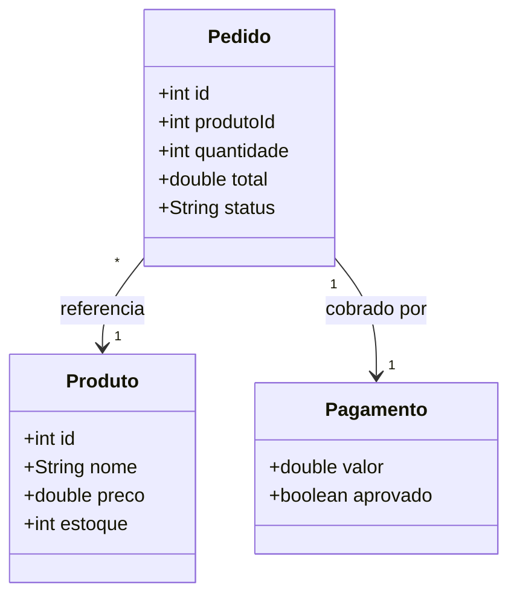
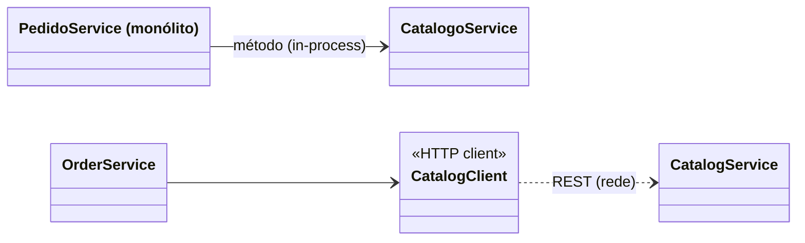
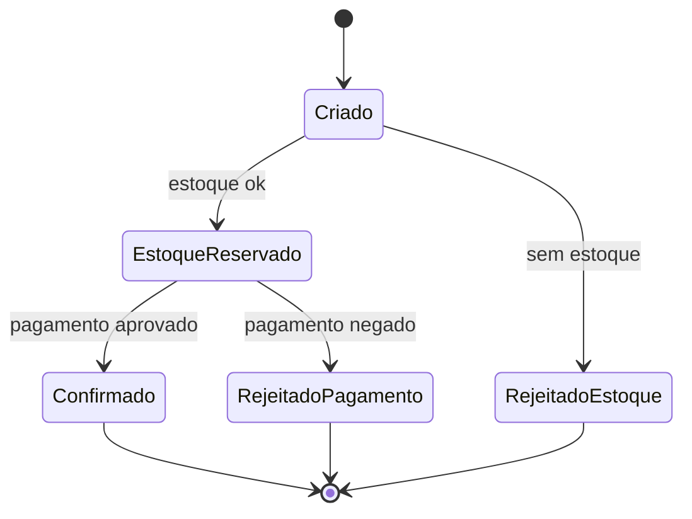
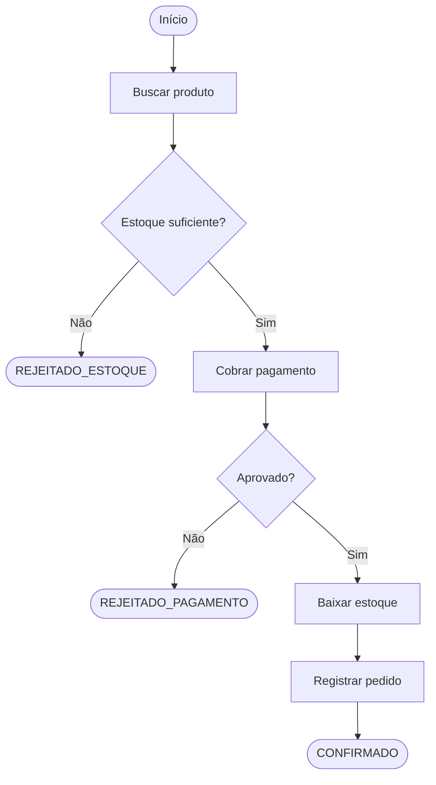
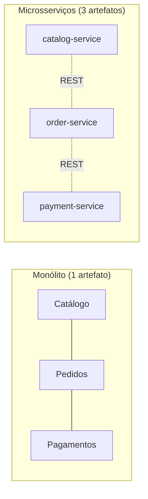
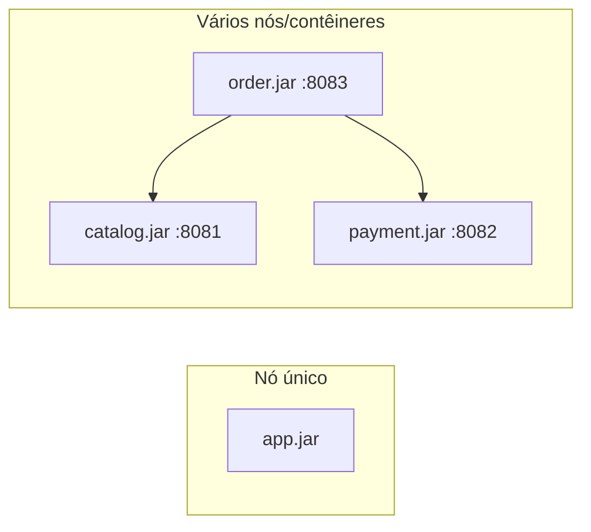

# Diagramas UML

Cenário: **criar um pedido** (`POST /pedidos?produtoId=1&quantidade=2`).

## Sequência — Monólito

## Sequência — Microsserviços

## Sequência — Falha parcial (Saga com compensação)

## Classes — Domínio compartilhado

## Classes — Acoplamento: monólito × microsserviços

## Estados — Pedido

## Atividades — Fluxo de criação de pedido

## Componentes

## Implantação

