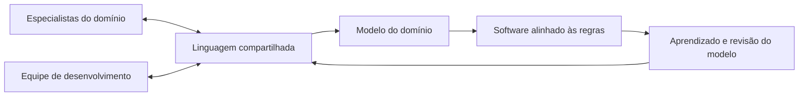
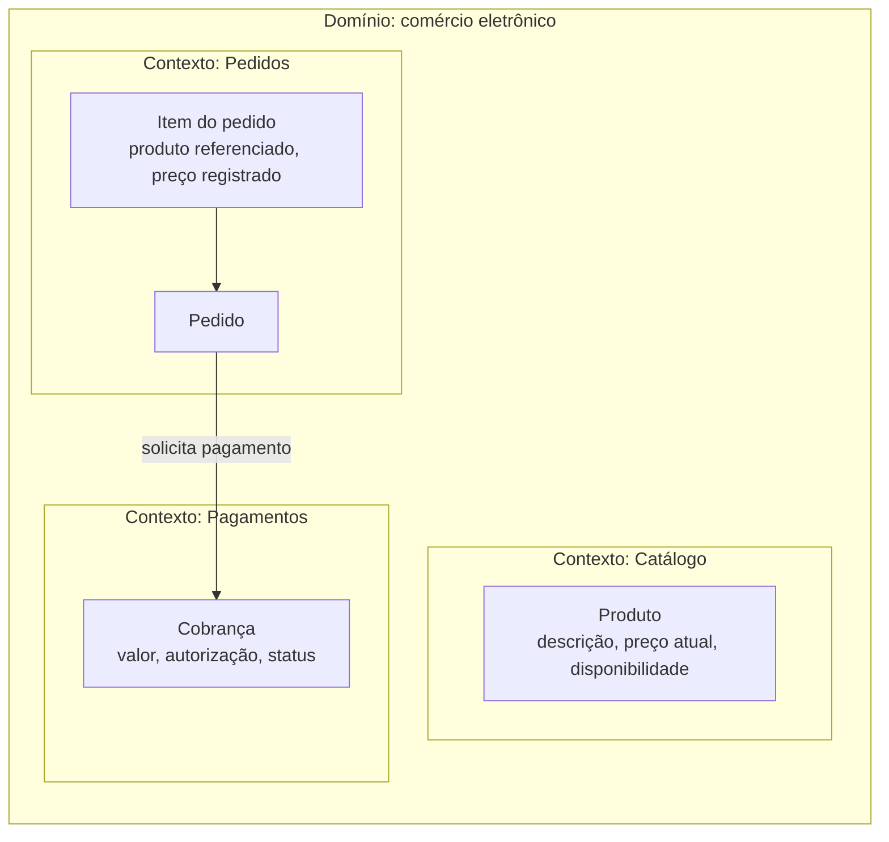
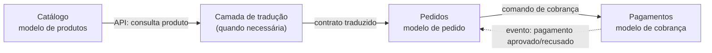
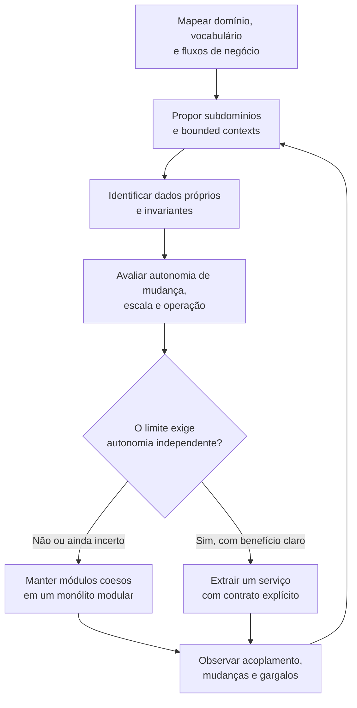
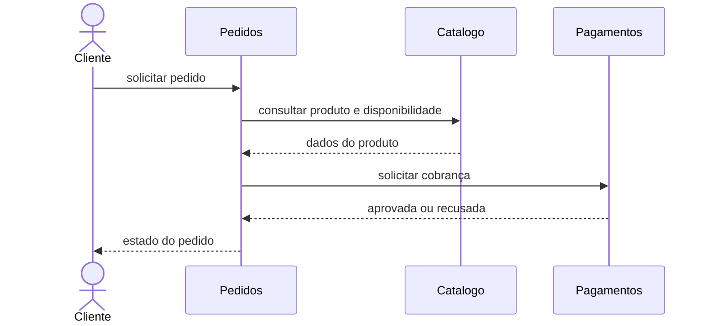
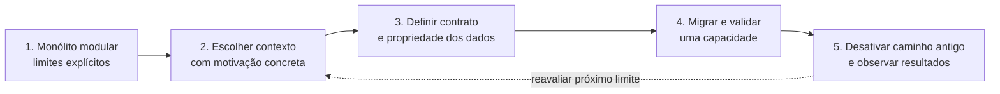

# DDD e decomposição de microsserviços

Este guia conecta **Domain-Driven Design (DDD)** à decisão de onde estabelecer os limites de um microsserviço. Os exemplos usam a loja online deste projeto — Catálogo, Pedidos e Pagamentos — como ilustração; não prescrevem uma estrutura única para todo sistema.

## O que é DDD

DDD é uma abordagem para desenvolver software em domínios complexos, colocando o conhecimento do negócio no centro das conversas, do modelo e do código. Não é uma arquitetura de microsserviços: pode ser aplicado em um monólito modular, e não exige que cada conceito do domínio vire um serviço.

O trabalho começa pela colaboração entre especialistas do domínio e pessoas de tecnologia. A equipe identifica regras, processos, termos ambíguos e diferenças de linguagem. O modelo deve representar essas regras de forma útil e evoluir conforme o entendimento do domínio amadurece.

## Domínio, subdomínios e linguagem ubíqua

- **Domínio:** o campo de conhecimento e atividade que o sistema atende, como comércio eletrônico.
- **Subdomínio:** uma parte do problema de negócio, como gerenciar catálogo, processar pedidos ou receber pagamentos.
- **Linguagem ubíqua:** vocabulário explícito, compartilhado por especialistas e equipe, usado nas conversas e refletido no modelo e no código. Termos ambíguos devem ser esclarecidos, não escondidos atrás de nomes técnicos.

Uma classificação comum de subdomínios ajuda a priorizar esforço, mas não determina automaticamente a topologia:

| Tipo | Papel | Exemplo ilustrativo |
|---|---|---|
| Core (núcleo) | Diferencia o negócio; merece investimento em conhecimento e implementação próprios | Regras de oferta e precificação, se forem diferenciais da loja |
| Supporting (suporte) | Necessário ao negócio, mas não é seu principal diferencial | Fluxo de atendimento de pedidos |
| Generic (genérico) | Capacidade comum que pode ser comprada ou reutilizada | Autenticação ou envio de e-mail |

Os exemplos são hipotéticos: a classificação correta depende da estratégia e das regras reais do negócio.

## Bounded context: limite do modelo

Um **bounded context** (contexto delimitado) é o limite dentro do qual um modelo e seus termos têm significado consistente. A mesma palavra pode representar conceitos diferentes em contextos distintos. Por exemplo, “produto” no Catálogo pode incluir descrição e preço de venda; em Pedidos, pode interessar como uma referência e um retrato do preço no momento da compra.

Isso não significa que sempre se devam criar bancos, equipes ou serviços separados. O contexto é primeiro um limite semântico e de responsabilidade; a arquitetura física é uma decisão posterior, guiada por autonomia, implantação, escala e custo operacional.

Cada contexto deve proteger seu modelo. Em vez de compartilhar tabelas ou classes internas entre contextos, integre-os por contratos explícitos, como uma API ou eventos. Uma tradução entre modelos pode ser necessária quando um contexto consome a linguagem de outro; em DDD, esse papel é frequentemente chamado de **anticorruption layer**.

## DDD estratégico e tático

DDD estratégico ajuda a decidir **quais modelos e limites existem** e como se relacionam. DDD tático oferece ferramentas para modelar regras dentro de um contexto; não é necessário aplicar todos os padrões em todo lugar.

| Conceito tático | Uso |
|---|---|
| Entidade | Objeto com identidade e ciclo de vida próprios |
| Value object | Valor definido por seus atributos, idealmente imutável |
| Agregado | Conjunto de objetos tratado como unidade de consistência; uma raiz controla suas alterações |
| Repositório | Abstração para recuperar e persistir agregados |
| Serviço de domínio | Regra de domínio que não pertence naturalmente a uma entidade ou value object |
| Evento de domínio | Fato relevante que ocorreu no modelo, expresso na linguagem do contexto |

Agregados orientam consistência **dentro** do modelo, mas não são uma receita para criar microsserviços. Em sistemas distribuídos, manter uma transação ACID envolvendo serviços diferentes tende a ser inviável; invariantes entre contextos podem exigir processos assíncronos, consistência eventual e compensações.

## Context map: relações entre contextos

Um **context map** descreve como contextos se integram, incluindo dependências e limites de tradução. As relações abaixo são possibilidades: o formato correto depende de quem controla o modelo e do contrato acordado.

Os rótulos mostram possíveis contratos, não uma implementação obrigatória. Um contrato deve esclarecer semântica, versão, responsabilidade por dados, falhas esperadas e compatibilidade.

## Estratégias para decompor um sistema

Não existe uma regra mecânica para descobrir serviços. Use as estratégias como lentes complementares, valide limites com pessoas do domínio e refine-os à medida que o sistema e o conhecimento evoluem.

### 1. Por subdomínios e bounded contexts

Identifique áreas com vocabulário, regras e modelos próprios. É um bom ponto de partida porque reduz ambiguidades e aproxima o desenho técnico das responsabilidades do negócio. Um contexto pode virar um serviço, mas também pode continuar como módulo independente dentro de um monólito.

### 2. Por capacidades de negócio

Agrupe comportamentos que entregam uma capacidade percebida pelo negócio, em vez de separar por camadas técnicas, como “serviço de banco”, “serviço de validação” ou um único serviço genérico de CRUD. Uma capacidade costuma incluir as partes necessárias para evoluir uma responsabilidade de ponta a ponta.

### 3. Por propriedade dos dados e invariantes

Cada limite precisa de uma autoridade clara para alterar seus dados. Um serviço não deve depender de escrever diretamente nas tabelas internas de outro. Pergunte quais regras precisam de consistência imediata juntas e quais podem ser atendidas por contratos e atualização eventual. Uma transação que atravessa muitos limites pode indicar fronteiras ruins ou um fluxo distribuído que precisa ser modelado explicitamente.

### 4. Por fluxo de negócio

Siga um caso de uso de ponta a ponta e identifique responsabilidades, decisões e fatos que passam entre contextos. Um fluxo pode envolver vários serviços sem que eles precisem compartilhar a mesma transação. Torne explícitos os estados intermediários, as falhas e as ações compensatórias — por exemplo, o que fazer se o pagamento falhar após a reserva do estoque.

### 5. Por autonomia de mudança, escala e operação

Verifique se partes do sistema precisam de ritmos de mudança, equipes, requisitos de escala ou perfis de disponibilidade diferentes. Esses fatores podem justificar um serviço separado, desde que o ganho de autonomia compense o custo de rede, implantação, monitoramento, suporte e consistência distribuída.

## Aplicação ao exemplo do projeto

O projeto já separa **Catálogo**, **Pedidos** e **Pagamentos** em módulos e serviços. A leitura abaixo é um ponto de partida para discussão: não prova que esses são os únicos ou melhores limites para uma loja real.

| Contexto candidato | Responsabilidade e dados sob sua autoridade | Integração ilustrativa |
|---|---|---|
| Catálogo | Produtos, informações de venda e disponibilidade/estoque | Responder consultas e aplicar alterações autorizadas |
| Pedidos | Ciclo de vida, itens e total registrado no momento da compra | Consultar dados necessários e coordenar o fluxo do pedido |
| Pagamentos | Cobranças, autorizações e resultado do pagamento | Receber uma solicitação e comunicar o resultado |

Um fluxo possível começa com a criação de um pedido, consulta o Catálogo, solicita uma cobrança e registra o resultado. O exemplo do repositório usa chamadas HTTP síncronas; a comunicação assíncrona é outra opção, não um requisito de DDD.

Em uma implementação distribuída mais resiliente, o fluxo precisaria também definir timeout, repetição segura (idempotência), estados pendentes e recuperação de falhas. Um **Saga** modela uma sequência de transações locais e, quando necessário, ações compensatórias; não transforma essas etapas em uma transação ACID global.

## Sinais de limites inadequados

- **Serviços pequenos demais:** mudanças simples exigem alterações coordenadas em muitos serviços ou várias chamadas em cadeia.
- **Serviços grandes e sem coesão:** muitas regras sem relação evoluem juntas e disputam deploy ou escala.
- **Banco compartilhado como integração:** um serviço altera tabelas ou conhece o esquema interno de outro.
- **Divisão por camada técnica:** mudanças de uma capacidade atravessam serviços de API, negócio e persistência que pertencem a equipes distintas.
- **Consistência distribuída invisível:** o fluxo presume sucesso simultâneo, mas não define timeouts, duplicidade, compensação ou reconciliação.

Um limite precisa equilibrar coesão interna e baixo acoplamento externo. Se uma fronteira ainda não está clara ou não há necessidade concreta de implantação independente, módulos bem isolados em um monólito são um ponto de partida válido.

## Decomposição gradual

Evite transformar todos os módulos em serviços de uma vez. Uma estratégia incremental é manter o sistema organizado por módulos, esclarecer contratos e propriedade dos dados e, quando houver uma razão concreta, extrair um contexto por vez. O padrão **Strangler Fig** direciona gradualmente as funcionalidades para a nova implementação, mantendo o sistema antigo durante a transição.

## Referências conceituais

- Eric Evans, *Domain-Driven Design: Tackling Complexity in the Heart of Software*.
- Vaughn Vernon, *Implementing Domain-Driven Design*.
- Sam Newman, *Building Microservices*.
