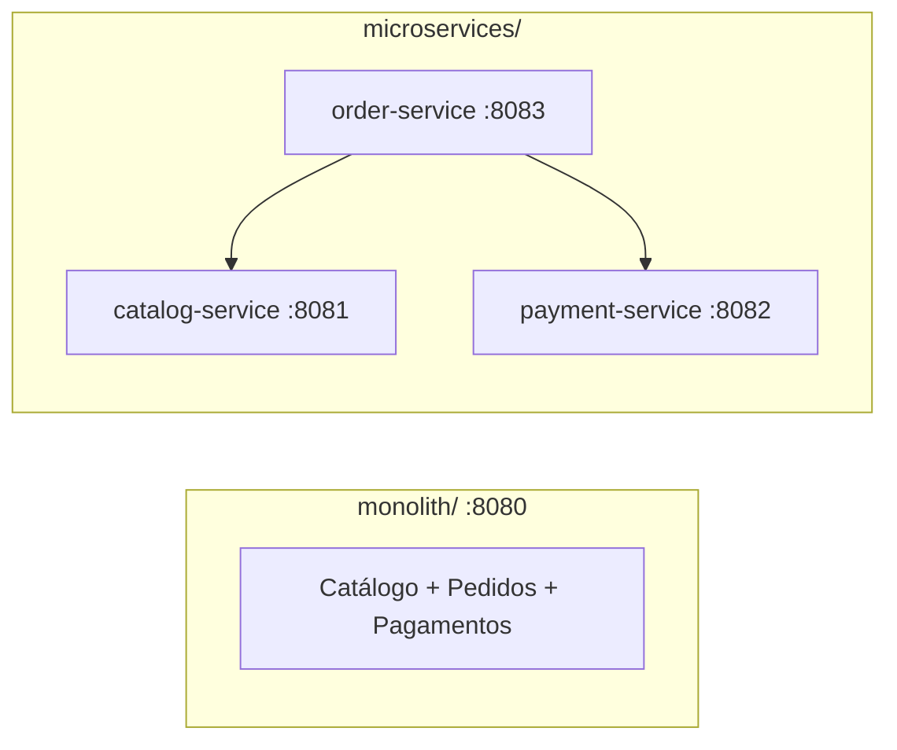

# Monólito × Microsserviços

Projeto didático com **código Java** (JDK puro, sem dependências) e **documentação visual** (C4 + UML em Mermaid, renderizados direto no GitHub).

O mesmo domínio (Catálogo, Pedidos, Pagamentos) é implementado das duas formas.



## Estrutura

| Caminho | Conteúdo |
|---|---|
| [`monolith/`](monolith) | Aplicação única, módulos se chamam por método |
| [`microservices/`](microservices) | 3 serviços independentes se chamando via HTTP |
| [`docs/01-conceitos.md`](docs/01-conceitos.md) | Comparativo, escalabilidade, falhas, migração, padrões |
| [`docs/02-c4-monolito.md`](docs/02-c4-monolito.md) | C4: contexto, contêineres, componentes, código, deployment |
| [`docs/03-c4-microservices.md`](docs/03-c4-microservices.md) | C4 dos microsserviços + mensageria |
| [`docs/04-uml.md`](docs/04-uml.md) | UML: sequência, classes, estados, atividades, componentes, implantação |
| [`docs/05-ddd-decomposicao-microservices.md`](docs/05-ddd-decomposicao-microservices.md) | DDD, bounded contexts e estratégias de decomposição de microsserviços |
| [`run.sh`](run.sh) | Compila e executa |

## Executando (requer JDK 17+)

```bash
./run.sh monolith          # http://localhost:8080
./run.sh microservices     # order :8083, catalog :8081, payment :8082
```

Testando:

```bash
# monólito
curl -X POST 'localhost:8080/pedidos?produtoId=1&quantidade=2'
# microsserviços
curl -X POST 'localhost:8083/pedidos?produtoId=1&quantidade=2'
curl localhost:8081/produtos/1     # estoque caiu para 8
```

## Experimento sugerido

1. Suba os microsserviços e derrube só o `payment-service`: `POST /pedidos` retorna **503**, mas `GET localhost:8081/produtos` segue funcionando (isolamento — e o preço: dependência de rede).
2. No monólito, a mesma lógica é uma chamada de método, sem rede e com transação única.

## Resumo

| | Monólito | Microsserviços |
|---|---|---|
| Simplicidade | ✅ | ❌ |
| Deploy/escala independentes | ❌ | ✅ |
| Consistência forte | ✅ | ❌ (Saga) |
| Autonomia de times | ❌ | ✅ |

Detalhes e todos os diagramas em [`docs/`](docs).
